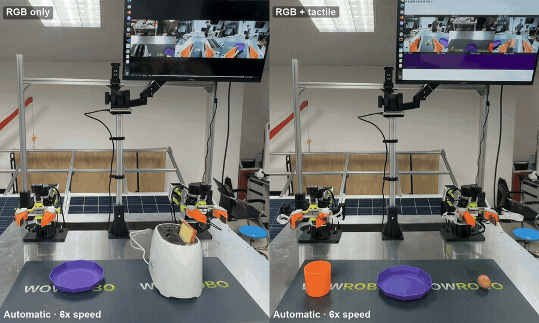

<div align="center">
  <h1>Rebot_LeRobot</h1>
  <p>B601 DM single-arm and bimanual robot learning with LeRobot</p>
</div>

# 📖 Introduction

**Rebot_LeRobot** integrates the **reBot Arm B601 DM**, **Quest 3**, **Nintendo Switch Joy-Con**, and **FlexiTac** into a practical workflow for real-world robot learning.

The project follows the LeRobot command-line workflow, from teleoperation and demonstration collection to policy training and real-world inference:

- 🦾 **Robot Control**: Single-arm and bimanual B601 DM followers with built-in grippers.
- 🕹️ **Teleoperation**: Quest 3 VR and Switch Joy-Con controller.
- 📦 **Multimodal Data**: RGB cameras, robot state, and optional four-pad FlexiTac sensing.
- 🚀 **Policy Learning**: ACT and Diffusion training and inference templates for RGB or RGB with tactile inputs.

| Category | Supported Options |
| --- | --- |
| Robot types | `seeed_b601_dm_follower`, `bi_seeed_b601_dm_follower` |
| Teleoperation backends | `quest3`, `switch_joycon` |
| Training recipes | ACT, Diffusion Policy |
| Policy inputs | RGB + robot state; RGB + robot state + tactile |

# 🖥️ Demos

<p align="center">
  
</p>

# 🛠️ Installation

Activate your Python environment, then run:

```bash
cd Rebot_LeRobot
bash scripts/install_rebot.sh
```

# 🧩 Hardware CAD Files

The [`hardware/`](hardware/) directory contains STEP CAD models for the gripper, camera mount, and FlexiTac components:

| File / Directory | Description |
| --- | --- |
| [`Soft_Gripper_Finger.step`](hardware/Soft_Gripper_Finger.step) | Soft gripper finger |
| [`Soft_Gripper_Mount.step`](hardware/Soft_Gripper_Mount.step) | Soft gripper mount |
| [`D415_Adjustable_Camera_Mount.step`](hardware/D415_Adjustable_Camera_Mount.step) | Adjustable mount for the D415 camera |
| [`FlexiTac/`](hardware/FlexiTac/) | Left/right housings (`Box_L`, `Box_R`), endcaps (`Endcap_L`, `Endcap_R`), and fastener models (`Bolt_x2`, `Nut_x2`) |

# 🕹️ Teleoperation

## Single-Arm Teleoperation

**Quest 3 VR**

```bash
lerobot-teleoperate --config_path=lerobot/configs/tele_vr_right.yaml
```

**Switch Joy-Con**

```bash
lerobot-teleoperate --config_path=lerobot/configs/tele_switch_right.yaml
```

## Bimanual Teleoperation

**Quest 3 VR**

```bash
lerobot-teleoperate --config_path=lerobot/configs/tele_vr_bi.yaml
```

**Switch Joy-Con**

```bash
lerobot-teleoperate --config_path=lerobot/configs/tele_switch_bi.yaml
```

# ⚙️ Data Collection

Use `lerobot-record` to collect demonstrations. Find the available camera devices first:

```bash
lerobot-find-cameras opencv
```

## Bimanual Switch Collection

**RGB + Robot State**

```bash
lerobot-record --config_path=lerobot/configs/collect_switch_bi.yaml
```

Default dataset: `data/bi`. This template uses three RGB cameras and Cartesian actions.

**RGB + Robot State + FlexiTac**

```bash
lerobot-record --config_path=lerobot/configs/collect_switch_bi_flexitac.yaml
```

## Bimanual Quest 3 Collection

**RGB + Robot State**

```bash
lerobot-record --config_path=lerobot/configs/collect_vr_bi.yaml
```

**RGB + Robot State + FlexiTac**

```bash
lerobot-record --config_path=lerobot/configs/collect_vr_bi_flexitac.yaml
```

## Episode Controls

The collection templates enable `manual_episode_control`:

| Key | Action |
| --- | --- |
| `c` | Start the current episode |
| `s` | Stop and save the current episode |
| `Backspace` | Discard the current unsaved episode |
| `Esc` | Exit |

## Sensor Preview and Tactile Processing

```bash
python scripts/test_flexitac.py --sensor left_inner
python scripts/test_flexitac.py --sensor left_outer
python scripts/test_flexitac.py --sensor right_inner
python scripts/test_flexitac.py --sensor right_outer
```

# ▶️ Dataset Replay

```bash
bash scripts/replay_data.sh data/bi 0
```

# 🚀 Training

## Train ACT

**RGB + Robot State**

```bash
lerobot-train --config_path=lerobot/configs/train_act.yaml
```

**RGB + Robot State + Tactile**

```bash
lerobot-train --config_path=lerobot/configs/train_act_flexitac.yaml
```

## Train Diffusion Policy

**RGB + Robot State**

```bash
lerobot-train --config_path=lerobot/configs/train_diffusion.yaml
```

**RGB + Robot State + Tactile**

```bash
lerobot-train --config_path=lerobot/configs/train_diffusion_flexitac.yaml
```

# 🤖 Evaluation

## RGB Evaluation

**ACT**

```bash
lerobot-record --config_path=lerobot/configs/eval_act_bi.yaml
```

**Diffusion Policy**

```bash
lerobot-record --config_path=lerobot/configs/eval_diffusion_bi.yaml
```

## RGB + Tactile Evaluation

**ACT**

```bash
lerobot-record --config_path=lerobot/configs/eval_act_bi_flexitac.yaml
```

**Diffusion Policy**

```bash
lerobot-record --config_path=lerobot/configs/eval_diffusion_bi_flexitac.yaml
```

## Inference Controls and Recording

Inference defaults to `recording_enabled: false`: the robot and OpenCV preview run without creating a dataset, buffering recording frames, or encoding video.

| Key | Action |
| --- | --- |
| `c` | Start inference |
| `s` | Stop inference; also save the episode if recording is enabled |
| `h` | Return to the connection startup pose, discard any unsaved episode, then wait for `c` |
| `Esc` | Exit |

To save an inference run, enable recording explicitly:

```bash
# First recording: the output dataset directory should not already exist
lerobot-record --config_path=lerobot/configs/eval_act_bi_flexitac.yaml \
  --recording_enabled=true --resume=false
```

# 🗂️ Project Structure

```text
Rebot_LeRobot/
├── README.md
├── hardware/                       # STEP CAD models for mechanical parts
│   ├── D415_Adjustable_Camera_Mount.step
│   ├── Soft_Gripper_Finger.step
│   ├── Soft_Gripper_Mount.step
│   └── FlexiTac/                   # Housings, endcaps, and fastener models
├── scripts/
│   ├── install_rebot.sh            # Installation entry point
│   ├── replay_data.sh               # Replay entry point
│   ├── replay_dataset.py            # Joint-trajectory replay
│   └── test_flexitac.py             # Standalone tactile test
├── lerobot/
│   ├── configs/                    # Teleoperation, collection, training, inference
│   ├── pyproject.toml              # Package dependencies and CLI entry points
│   ├── setup.py
│   ├── LICENSE
│   ├── native/
│   │   ├── rebotarm_control_dm/     # Native control backend and robot resources
│   │   └── motorbridge/            # Motor communication components
│   └── src/lerobot/                # LeRobot and B601 integrations
└── UR5e-LeRobot-main/               # Reference project, when present; not a runtime dependency
```

# 📄 License

The LeRobot code is distributed under [Apache-2.0](lerobot/LICENSE).

# 🙏 Acknowledgements

This project builds on [LeRobot](https://github.com/huggingface/lerobot) and integrates the B601 DM control backend, motorbridge, Quest 3, Switch Joy-Con, and FlexiTac components. We thank the authors and maintainers of these projects for their contributions.
